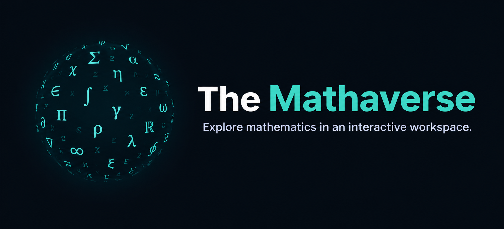
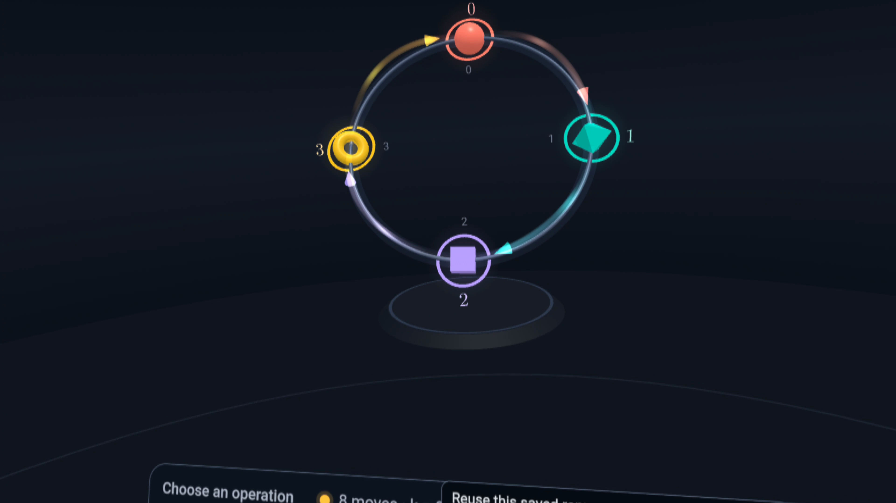
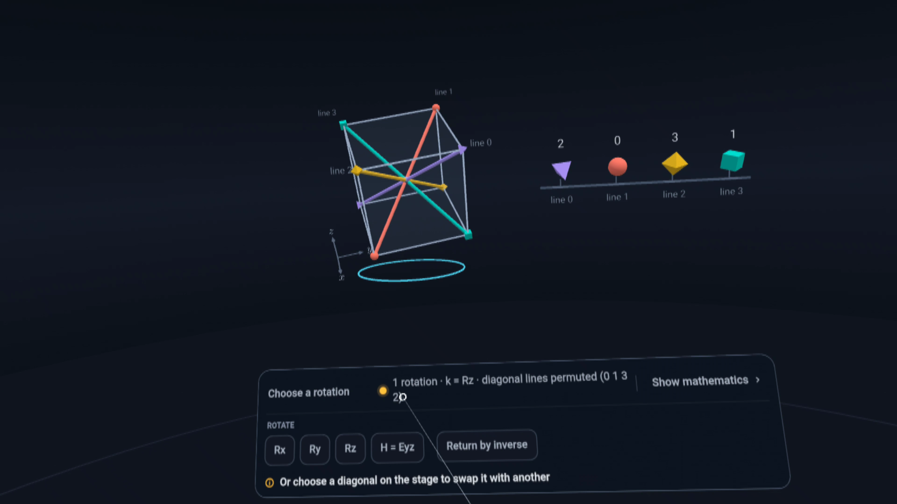
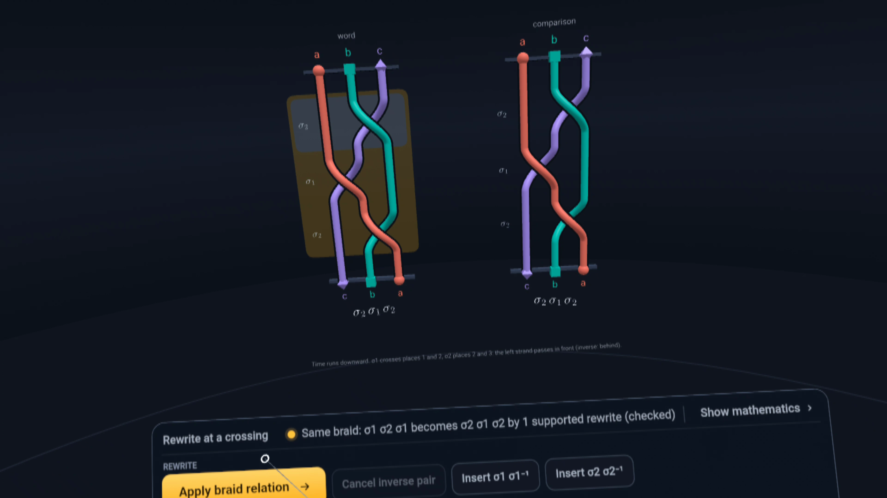

# The Mathaverse

**Explore mathematics in an interactive workspace—with Meta Muse AI helping you change the experiment.**

The Mathaverse brings mathematical objects, reusable visualizations and supported proof checks into a shared desktop and WebXR workspace. Ask a question, change an operation, compare the result, and inspect the mathematics behind what you see.

Built for the Meta Global AI Developer Hackathon. The source is available under the [MIT licence](LICENSE).

## Inside the workspace

Captured in the headset. Select an image to see it at full resolution.

| Groups of order four | Cube rotations | Braid relations |
|---|---|---|
| [](docs/images/sculpture-vr.png) | [](docs/images/cube-vr.png) | [](docs/images/braids-vr.png) |
| Explore C₄ and V₄ through the same kinetic sculpture. | See how rotating a cube permutes its body diagonals. | Change a braid using a supported relation and compare the result. |

## Try it locally

You need **Node.js 20.19 or later** and npm. The project has been tested on Apple silicon macOS with Node 20.19.5. A headset, API key and Lean installation are optional for exploring the scenes.

```sh
git clone https://github.com/aThoughtfulSoul/mathaverse.git
cd mathaverse
npm ci
npm run dev:local
```

Open **http://localhost:3010**. Choose an experiment from **Experiments**. Without a key, assistant replies use clearly labelled synthetic fixtures; the mathematical workspace still runs.

For live Meta Muse and Meta speech-to-text, run this instead of the last command:

```sh
zsh scripts/muse-live.sh serve
```

Enter your own Meta API key at the hidden prompt. It stays on the local backend. Live access depends on your Meta account's access to the configured models. Voice additionally needs ffmpeg. Text and suggested questions work without a microphone.

See the [setup guide](docs/LOCAL-SUBMISSION.md) for prerequisites, optional Lean checks and the headset workflow.

## Explore seven experiments

| Experiment | What you can investigate |
|---|---|
| **Projections** | Apply one representation to two linear maps and see which inputs share an output. |
| **Composition order** | Compare rotating then reflecting with reflecting then rotating. Change a branch and replay the comparison. |
| **Groups of order four** | Reuse one kinetic sculpture for C₄ and V₄, revealing their different cycle structures. |
| **Cube rotations** | Connect the cube's 24 rotations with permutations of its four body diagonals. |
| **Quotient groups** | Group rotations by their action on the three pairs of opposite faces. |
| **Braid relations** | Explore supported rewrites and deformations of three-strand braids. |
| **Steinitz lemma** | Explore a prepared reordering argument from a published proof and check a supported finite instance. |

Changes use validated transactions, with Undo, Save, Reopen, Export and Import. A saved visualization recipe can be reused with compatible mathematics.

## How Meta Muse participates

1. **Context:** the backend supplies the selected experiment, selection, exact computed facts and available actions to Muse.
2. **Reasoning and actions:** Muse responds with an explanation and a structured proposal using supported workspace operations.
3. **Validation and execution:** Mathaverse validates the proposal against the document, applies valid transactions, computes the result and updates the visualization. Stale responses cannot overwrite a changed workspace.
4. **Evidence:** supported claims can be sent to the local Lean checker. A successful receipt is tied to the exact claim and current example.

This is a bounded action system. Muse does not execute arbitrary generated code or invent new mathematical domains. Developer extensions can add domains, visual representations and supported actions. AI explanations can still be mistaken; computed facts and Lean receipts are presented separately.

| Model/tool | Role | Where it runs |
|---|---|---|
| Meta `muse-spark-1.3` | Assistant reasoning and structured actions through the Responses API | Meta's API, called by the local backend |
| Meta `muse-voice-transcribe-1.0` | Optional push-to-talk transcription | Meta's API, called by the local backend |
| Lean 4.26.0 | Supported finite-instance proof checks | Your computer |
| ffmpeg | Audio conversion for transcription | Your computer |

The browser records your question, the backend sends it to Meta for transcription, and you can review the transcript before it becomes a Muse request. If speech is unavailable, you can type your question.

<!-- Speech architecture: ffmpeg converts audio; Meta transcribes it; Muse interprets the text.
     Validated workspace actions update the scene; transcription errors are shown in the interface. -->

## What a Lean check establishes

Lean checks the generated statement about the exact rational data in the current example. The backend checks the pinned toolchain and audits the theorem's axiom report before issuing a receipt. It does not certify every AI explanation, every visualization, the general Steinitz lemma or an entire research paper. This project uses Lean core; it does not include Mathlib.

The prepared proof lesson draws on `OAI.EuclideanSteinitzBergstrom.signedOrder_prefix_bound` from OpenAI's released formalization of *The Euclidean Steinitz–Bergström theorem*, pinned to [commit 4eaee875](https://github.com/openai/math/tree/4eaee87548250b2682affda7d05d947c05554bae). The underlying argument predates that release. This is an authored lesson, not automatic PDF-to-visualization conversion. [Source attribution](third_party/openai-math-steinitz/NOTICE.md).

## Build and verify

```sh
npm run patch:check
npm run typecheck
npm test
npm run build
```

`npm ci` applies a version- and hash-guarded patch to manim-web's nested-SVG handling. The lockfile pins the dependency tree. Some tests depend on optional tools such as Lean, ffmpeg or system audio support; live API tests require explicit opt-in. No Meta key is needed for the normal test suite.

The static build alone does not provide the assistant, transcription or checker routes. Keep the local backend running for those features. There is no hosted service bundled with this repository.

See the [release checks](docs/RELEASE-CHECK.md) for the verified install/build results and the audio-test limitations in the packaging environment.

## Extend the workspace

The project is a source library and runnable application; it is not yet a separately published SDK. `"private": true` in package.json prevents accidental npm publication and does not make this GitHub repository private.

Start with [Extending the workspace](docs/EXTENDING.md), then run the reusable recipe example:

```sh
npx vite-node examples/cycle-recipe.ts
```

| Directory | Responsibility |
|---|---|
| `src/model/`, `src/algebra/` | Exact rational linear algebra, finite groups, braids and vector walks |
| `src/workspace/` | Documents, action validation, transactions, claims and mathematical context |
| `src/recipes/`, `src/domains/` | Reusable recipes and mathematical scene implementations |
| `src/rendering/`, `src/runtime/` | manim-web adapter, Three.js/WebXR host and interaction |
| `src/ui/` | Desktop and immersive interface |
| `server/muse/`, `server/speech/`, `server/lean/` | Assistant, transcription and proof-checking routes |
| `tests/` | Mathematical, application, integration and UI tests |

See [CONTRIBUTING.md](CONTRIBUTING.md) for a starting point. The current scope is seven authored experiments and a finite vocabulary of operations. Broader mathematics and general experiment generation are future work.

## Credits and licence

Original project code: [MIT](LICENSE). Created by [aThoughtfulSoul](https://github.com/aThoughtfulSoul).

The visual adapter uses [manim-web](https://github.com/maloyan/manim-web), [Three.js](https://github.com/mrdoob/three.js) and MathJax. IWER supports desktop emulation. The work is inspired by mathematical exposition such as 3Blue1Brown's. It is an independent project.

Third-party software and the upstream proof formalization retain their own licences. See [THIRD_PARTY_NOTICES.md](THIRD_PARTY_NOTICES.md) and [dependency details](docs/DEPENDENCIES.md).
